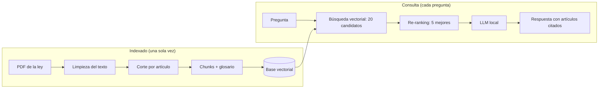

<p align="center">
  
</p>

<p align="center">
  
  
  
  
  
</p>

# Asistente de Regulación Bancaria (RAG + LLM local)

Un asistente que responde preguntas en español sobre la **Ley de Instituciones
de Crédito** de México. Cada respuesta se genera únicamente a partir del texto
de la ley, cita el artículo que la respalda y, si la ley no contiene la
respuesta, lo dice en lugar de inventar.

Todo corre en local: los modelos de búsqueda y el modelo de lenguaje se
ejecutan en la computadora, sin enviar datos a servicios externos.

🎬 **[Video explicativo del proyecto](assets/video_explicativo_rag.mp4)**

<!-- Cuando grabes el demo, guárdalo en assets/demo.gif y descomenta esta línea:
<p align="center"></p>
-->

## El problema

La regulación bancaria son cientos de páginas en lenguaje jurídico. Encontrar
qué artículo aplica a una situación concreta toma tiempo, y un modelo de
lenguaje por sí solo no es confiable para esto: contesta de memoria, puede
citar artículos que no existen y no distingue la versión vigente de la ley.

## La solución

Un sistema RAG (*Retrieval-Augmented Generation*): primero se buscan en la ley
los fragmentos relevantes y después un modelo de lenguaje redacta la respuesta
usando solo esos fragmentos.



## Cómo funciona

| Etapa | Qué hace | Con qué |
|---|---|---|
| Ingesta | Extrae el texto del PDF, quita encabezados, notas de reforma y artículos transitorios | PyMuPDF, expresiones regulares |
| Chunking | Corta por artículo (481) y divide los largos entre párrafos (799 chunks de máx. ~1,500 caracteres) | Python |
| Glosario | Agrega notas a los chunks que citan delitos solo por número de artículo | Reglas propias del dominio |
| Embeddings | Convierte cada chunk en un vector de 768 dimensiones | `intfloat/multilingual-e5-base` |
| Base vectorial | Guarda vectores, texto original y metadatos (artículo, fuente) | ChromaDB |
| Re-ranking | Reordena los 20 candidatos leyendo pregunta y chunk juntos | `cross-encoder/mmarco-mMiniLMv2-L12-H384-v1` |
| Generación | Redacta la respuesta citando artículos, con temperatura 0 | Gemma 3 4B en Ollama |
| Interfaz | Chat web local | Gradio |

## Resultados

La búsqueda se evaluó con 22 preguntas escritas en lenguaje coloquial, cada
una con su artículo esperado verificado a mano contra la ley.

| Versión | Recall@5 | MRR |
|---|---|---|
| `multilingual-e5-small` (línea base) | 64% | 0.37 |
| `multilingual-e5-base` | 64% | 0.47 |
| **`multilingual-e5-base` + re-ranking (versión final)** | **73%** | **0.61** |
| `multilingual-e5-base` + fusión RRF (descartada) | 68% | 0.55 |

- **Recall@5:** en qué porcentaje de las preguntas el artículo correcto llegó
  al modelo de lenguaje.
- **MRR:** qué tan arriba aparece el artículo correcto (1 = siempre primero).

El detalle por pregunta y la explicación de cada experimento están en
[`evaluacion/resultados.md`](evaluacion/resultados.md).

## Hallazgo: la ley cita delitos sin nombrarlos

La pregunta *"¿Qué deben hacer los bancos para prevenir el lavado de dinero?"*
no encontraba el artículo que regula el tema (el 115). Al inspeccionar los
datos, la causa no estaba en el modelo: **la ley nunca usa la expresión
"lavado de dinero"**. El artículo 115 se refiere a "los delitos previstos en
los artículos 139 ó 148 Bis del Código Penal Federal" y a "los supuestos del
artículo 400 Bis del mismo Código". Ningún modelo de búsqueda por significado
puede relacionar un número de artículo con un concepto que no está escrito.

La solución fue un **glosario del dominio**: durante la ingesta, a los chunks
que citan esos artículos se les agrega una nota que explica el concepto. La
nota se usa para calcular el embedding y se guarda aparte; el texto original
de la ley no se modifica. Con ese cambio el artículo 115 pasó de no aparecer
entre los cinco resultados a aparecer en ellos.

## Limitaciones

- **Vocabulario coloquial contra jurídico.** Seis de las 22 preguntas siguen
  fallando, casi todas porque la pregunta usa palabras de uso común y la ley
  usa términos legales.
- **Conjunto de evaluación pequeño.** Con 22 preguntas, cada una pesa 4.5
  puntos; los porcentajes son orientativos.
- **Solo se evalúa la búsqueda.** La calidad de la redacción del modelo de
  lenguaje se revisó de forma manual, no con métricas.
- **Artículos largos.** Un artículo extenso se reparte en varios chunks y el
  modelo puede recibir solo una parte, por lo que algunas respuestas quedan
  incompletas.
- **Velocidad.** El modelo de lenguaje corre en CPU y tarda alrededor de
  20 segundos por respuesta.
- **Cobertura.** Incluye una sola ley.

## Trabajo futuro

- Expandir la pregunta con el modelo de lenguaje para acercarla al
  vocabulario de la ley antes de buscar.
- Hacer *fine-tuning* del modelo de embeddings con pares de pregunta y
  artículo de regulación mexicana.
- Agregar más documentos, como las Disposiciones de carácter general
  aplicables a las instituciones de crédito.
- Ampliar el conjunto de evaluación y medir también la calidad de las
  respuestas generadas.

## Estructura del proyecto

```
├── backend/
│   ├── ingesta.py       # PDF → artículos → chunks → glosario → base vectorial
│   ├── buscador.py      # Búsqueda vectorial + re-ranking
│   ├── generador.py     # Prompt + LLM local, respuesta con citas
│   └── app.py           # Interfaz web (Gradio)
├── evaluacion/
│   ├── preguntas.json   # 22 preguntas con su artículo esperado
│   ├── verificar.py     # Revisión manual del conjunto de prueba
│   ├── evaluacion.py    # Cálculo de Recall@5 y MRR
│   └── resultados.md    # Experimentos y resultados
├── datos/               # PDF de la ley (no incluido, ver instalación)
├── assets/              # Imágenes del repositorio
├── requirements.txt
└── README.md
```

## Instalación y uso

Requisitos: Python 3.11 y [Ollama](https://ollama.com).

```bash
# 1. Clonar el portafolio y entrar a la carpeta del proyecto
git clone https://github.com/CatoXP/portfolio-data-science.git
cd portfolio-data-science/01-ia-engineering/rag-regulacion-bancaria

# 2. Crear el entorno e instalar dependencias
python -m venv .venv
.venv\Scripts\activate          # En Linux o macOS: source .venv/bin/activate
pip install -r requirements.txt

# 3. Descargar el modelo de lenguaje
ollama pull gemma3:4b
```

4. Descarga el texto vigente de la
   [Ley de Instituciones de Crédito](https://www.diputados.gob.mx/LeyesBiblio/ref/lic.htm)
   en PDF y guárdalo en la carpeta `datos/`.

```bash
# 5. Indexar la ley (una sola vez; unos 2 minutos en CPU)
python backend/ingesta.py

# 6. Abrir el asistente
python backend/app.py
```

Para repetir la evaluación:

```bash
python evaluacion/evaluacion.py
```

## Aviso

Este proyecto es una demostración técnica con fines educativos y de
portafolio. Las respuestas no constituyen asesoría legal. La fuente es el
texto público de la Ley de Instituciones de Crédito publicado por la Cámara
de Diputados; el sistema se evaluó con la versión cuya última reforma es del
14 de noviembre de 2025.

## Autor

**Brandon Uriel García Sánchez**
[GitHub](https://github.com/CatoXP) ·
[LinkedIn](https://www.linkedin.com/in/brandon-uriel-garcia-sanchez-9ab77b320/)

Copyright (c) 2026 Brandon Uriel García Sánchez. Todos los derechos reservados.
